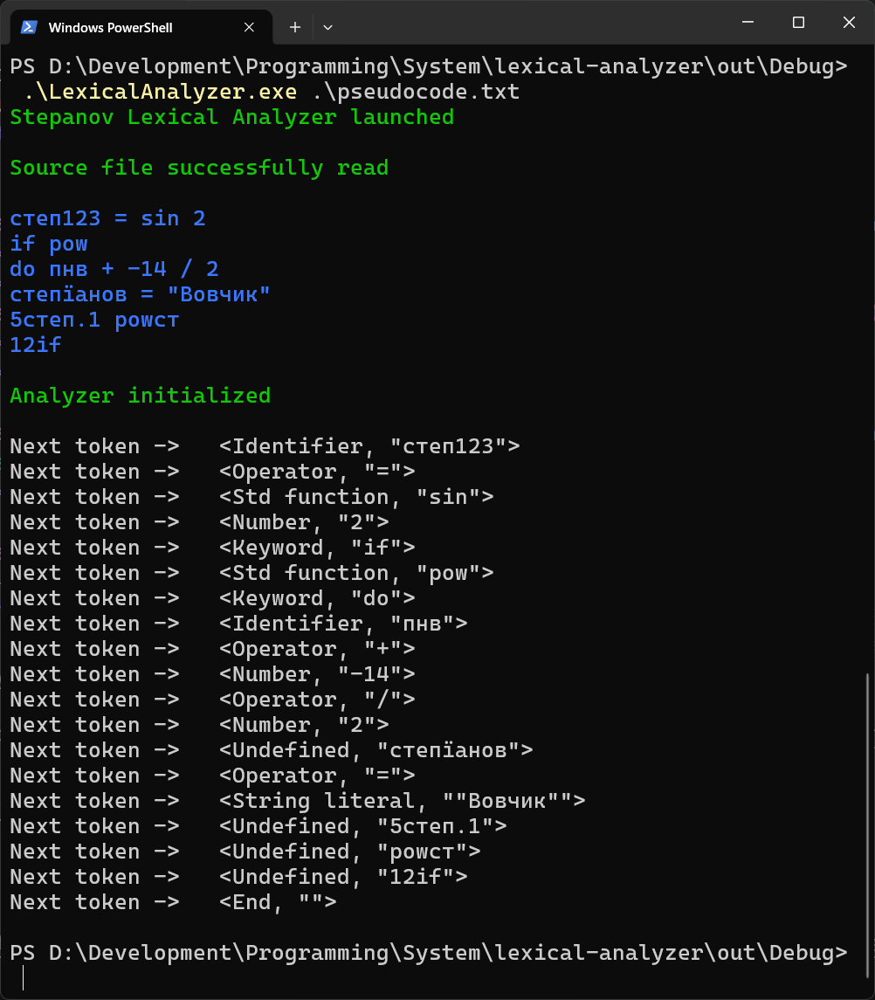

# lexical-analyzer

Примітивний лексичний аналізатор на основі Детермінованого Скінченого Автомату.

## Можливості розпізнання токенів

1. **Identifier** - Ідентифікатори, складені з символів українського алфавіту, взятих з мого прізвища (Степанов), та цифр
2. **StringLiteral** - Літерал стрічка символів (будь-яких)
3. **Number** - Цілі та дробні числа
4. **Operator** - Арифметичні оператори
5. **Keyword** - Зарезервовані слова (if, else, while...)
6. **Function** - Стандартна вбудована функція (sin, cos, pow...)
7. **Undefined** - Неправильно побудований токен
8. **End** - Кінець тексту

Програма отримує стрічку тексту з файлу та отримує і виводить кожен токен поки не дійде до кінця:
```cpp
vs::Token t;
while (t.token != vs::TokenType::End) {
    t = l.next_token();
    cout << t << endl;
}
```

Всі види лексем окрім Keyword та Function працюють на основі ДСА. Перші ж визначаються за зверненням в `std::map`, заповнену набором ключових слів та стандартних функцій.

Демонстрація роботи програми на прикладі взятого з *example/pseudocode.txt*:



Програма реалізована суто під ОС Windows - використовує відповідний тип `wchar_t` для роботи з кириличними символами та конвертацію стрічок в обидві сторони.

## Компіляція і запуск

Для побудови проєкту можна скористатись **CMake 4.3+**:

```ps1
cmake -B out -S .
cmake --build out --config Debug
```

Файл з псевдокодом можна покласти в одній зі скомпільованою програмою директорією:

```ps1
cd .\out\Debug\
.\LexicalAnalyzer.exe <назва файлу для аналізу>
```